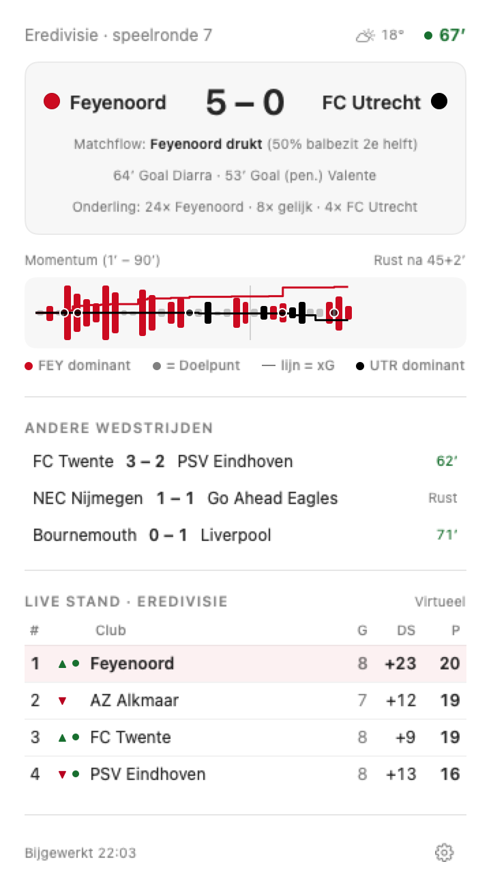
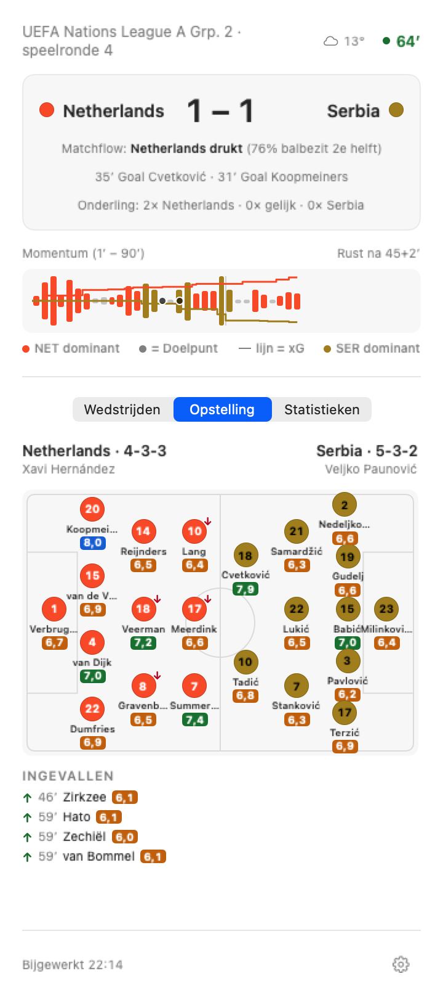

 

_The popover during a live match, and the line-ups one click further. Screenshots from the Dutch version of the app._

## The Challenge

When you can't watch, a score app tells you the result, not how the match is going. A 1–1 can mean your club is pinned back in its own half, or pressing for the winner. The data that shows the difference exists: momentum per minute, shots and xG, ratings. But where it is shown, it looks like a trading terminal: dark, dense and built for analysts.

I wanted the opposite: one glance in the menu bar to know how the match is going, and one click to understand why. Light, warm and calm, so it fits between other work instead of competing with it.

## My Role

This is a personal project. I wrote the product requirements and the specs, briefed and chose the visual direction, wrote the motion spec and the style guide, and made every product and design decision. The code was largely written by Claude Code. From the first commit to version 0.2 took three days, including three live tests during real matches.

## Approach

**The bar is the dominance.** The menu bar shows the two club codes, the score and a thin tug-of-war bar underneath: the home colour fills from the left up to the home side's share of the momentum over the last ten minutes. At first a percentage sat next to it. Without explanation, "51%" could not be read: whose, and of what? The percentage went; the bar already said it. The same idea became the app icon: a pitch seen from above, split at the front line, after two versions with momentum bars kept looking like an audio wave.

**Only show what is there.** The data comes from an unofficial source with no public API, and not every match has the same depth. When a field is missing, momentum, possession or ratings, that part of the interface disappears. Nothing is estimated or filled in, and the data layer is kept separate so the source can be replaced.

**Match days beat test data.** I tested the app live during three internationals, logging every response minute by minute. Those tests changed the design. In one match the score showed 2–1 a quarter of an hour before the goal event arrived, so a notification waiting for the event would have come far too late: Matchflow now announces a goal when the score changes and adds the scorer later. Mid-match, the source once sent an old copy from before kick-off; the app now recognises that and keeps the previous state, so the menu bar never jumps back. A fresh goal sometimes named its scorer as a placeholder for a minute; that placeholder is now treated as no name at all. During a VAR check the new score is held and nothing is announced. A goal that stands is announced once, and a disallowed goal never is.

**Interrupt on your terms.** Notifications have four levels: all goals and red cards, goals only, only your own club's goals, or off.

**Designing by removing.** Several ideas were built, looked at and taken out again: club colours as dots beside the team codes, then as upright strips like a TV score bug, and a soft colour wash across the match card. Stadium and referee are in the data but not on screen. Each one added colour or detail without adding understanding. What stayed is one bar, one sentence ("Feyenoord pressing, 58% possession in the second half") and a chart.

**Calm motion.** Only real changes move: the bar slides to a new value, the score rolls on a goal, a new minute grows into the chart. Nothing pulses, repeats or blinks, the menu bar item never changes width, and with Reduce Motion everything jumps straight to its end state.

## Impact

Matchflow 0.2 is in beta: it runs on Apple Silicon and Intel Macs with macOS 15, follows clubs in six European leagues and national teams, and updates itself with signed releases. More than a hundred tests run against real responses recorded during live matches. A mobile version, built on the same data layer, is the next step.

## Learnings

Removing turned out to be the most important design work. Most of what I built and then took out was technically fine; it just didn't make the match easier to read.

And real conditions are the only honest test. The fixtures were correct, but the match days showed how the data actually arrives: late, out of order, sometimes backwards. Designing for that is what makes a live product feel trustworthy.
